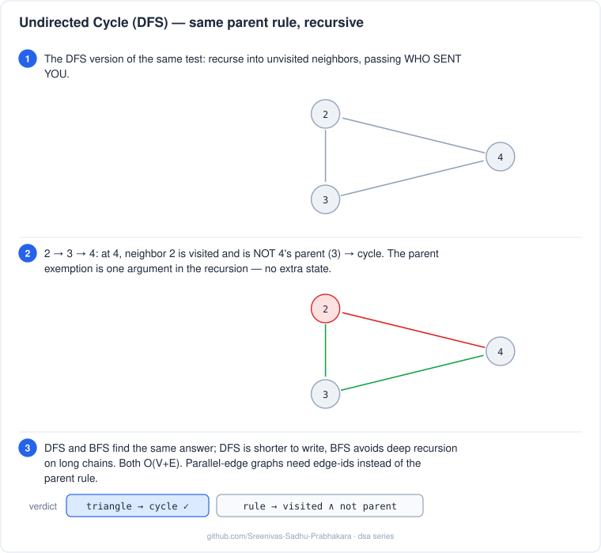

# Cycle in Undirected Graph (DFS)

> Striver SDE Sheet 156 · Day 23 Graph — DFS passing the parent down; a visited neighbor other than the parent closes a cycle. Go, stdlib only, tested.

## Problem

Cycle detection in an undirected graph, the DFS formulation — the sheet assigns both traversals so the parent trick is learned as a concept, not a BFS accident.

## Approach

Recursive DFS whose signature carries the arrival edge (`walk(v, parent)`). A neighbor already visited and ≠ parent means some earlier path already reached it — a cycle. The structural fact underneath: in an undirected graph explored by DFS, every non-tree edge is a *back edge* to an ancestor (there are no cross edges), so the first such edge encountered proves a cycle without any further analysis. Equivalent alternative worth knowing: union-find over the edge list — an edge whose endpoints already share a set closes a cycle; that formulation shines when edges stream in (as in Kruskal, #169).

**Complexity:** O(V+E) time, O(V) recursion.

## Visual walkthrough

Read the picture top to bottom — each numbered frame is one moment of the algorithm
running on this repo's test example.

## Run

    go test ./...   # verify
    go run .        # demo

---

One of 191 repos solving Striver's SDE Sheet in Go — stdlib only, one problem per repo, every solution tested. Browse the set: [`dsa-*` repos](https://github.com/Sreenivas-Sadhu-Prabhakara?tab=repositories&q=dsa-&type=source).
